# TURBO JANG!

Ikki rejimli 3D mashina o'yini:

- **Poyga** - Blur uslubidagi 4 kishilik qurolli poyga. To'rtta xaritadan birida yo'ldagi qutilardan qurol olib, uni oldinga yoki orqaga otib raqiblarni to'xtatasiz.
- **Parkovka** - bitta o'yinchi uchun 20 darajali parkovka ustasi: tor joylar, orqaga kirish, parallel turish, garaj va labirintlar.

Poygada o'yinchilar bitta Wi-Fi yoki telefon hotspoti orqali o'ynaydi, bo'sh joylarni botlar egallaydi.

O'yin to'liq **C tilida** yozilgan, grafika uchun [raylib](https://www.raylib.com/) ishlatilgan. Bitta koddan **Windows (.exe)** va **Android (.apk)** versiyalari yig'iladi, ular bir-biri bilan birga o'ynay oladi. Interfeysda [Poppins](https://github.com/itfoundry/Poppins) va [JetBrains Mono](https://github.com/JetBrains/JetBrainsMono) shriftlari ishlatilgan (SIL OFL 1.1).

| | |
|---|---|
| **F.I.Sh** | Homidov Abdukamol |
| **Guruh** | SRM002-2 |
| **Fan** | Operatsion tizimlar, 4-topshiriq (erkin mavzu, C tili) |
| **Mavzu** | "TURBO JANG!" — ko'p o'yinchili 3D poyga va parkovka o'yini (oqimlar, mutex, UDP soketlar) |
| **O'qituvchi** | Bekimmetova Durdona |

### Tezkor ishga tushirish

```bash
make          # o'yinni yig'ish (CMake + raylib avtomatik yuklanadi)
make run      # yig'ib, ishga tushirish
make test     # testlar: tarmoq, 4 xaritada poyga, 20 ta parkovka darajasi (faqat gcc kerak)
```

**Windows uchun tayyor o'yin:** [`bin/TurboJang.exe`](bin/TurboJang.exe) — yuklab olib, ikki marta bosing (o'rnatish shart emas). Android uchun `TurboJang.apk` **Actions** bo'limida yig'iladi.

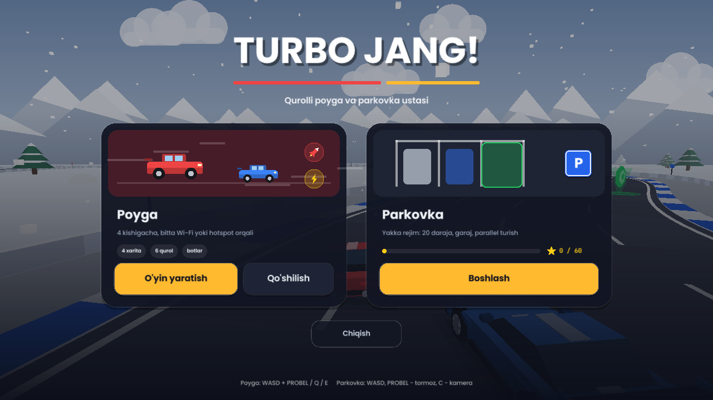

| Yashil vodiy | Cho'l |
|---|---|
| 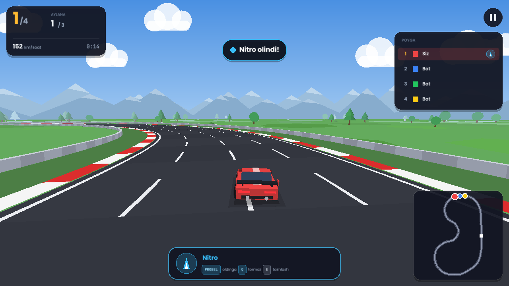 | 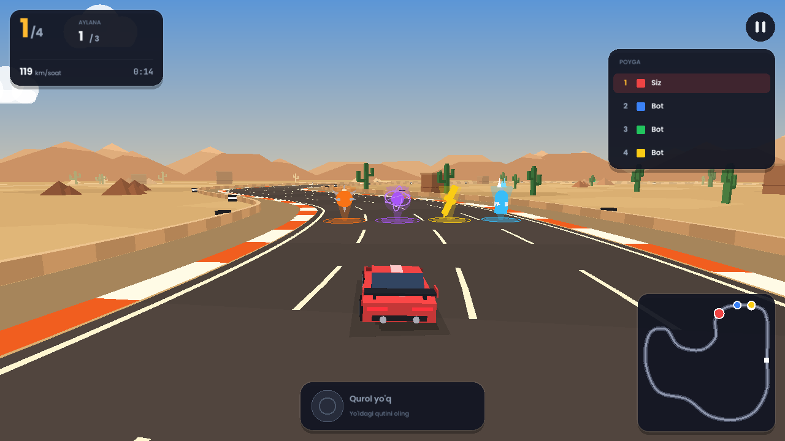 |

| Qorli tog' | Tungi shahar |
|---|---|
| 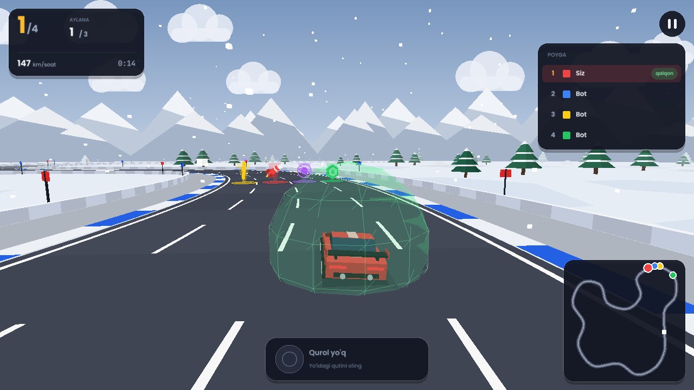 | 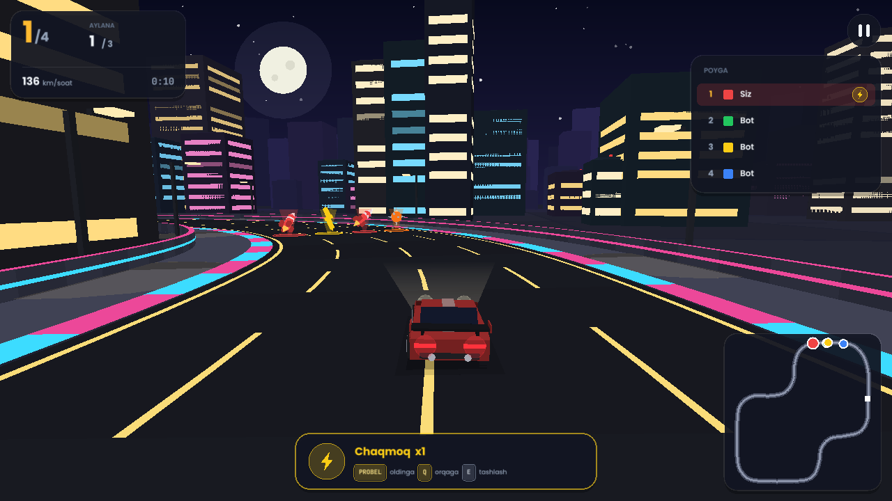 |

| Qurol qutilari (har birining o'z shakli bor) | Kutish xonasi |
|---|---|
| 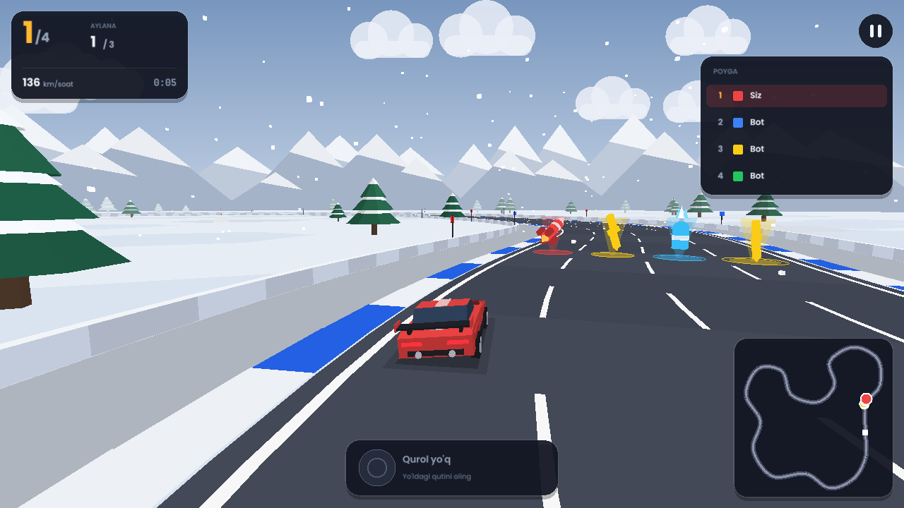 | 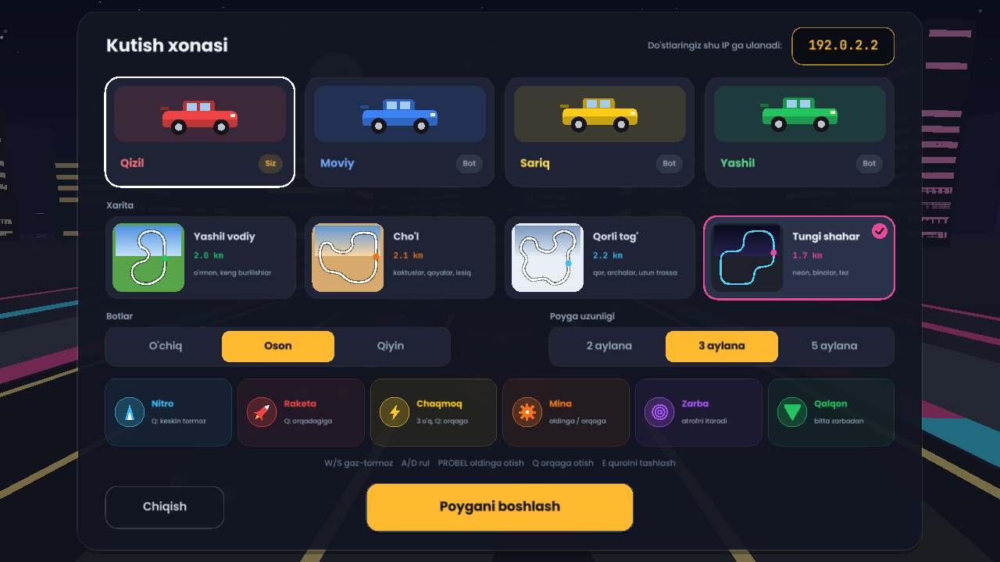 |

| Parkovka: darajalar | Parkovka: tungi labirint |
|---|---|
| 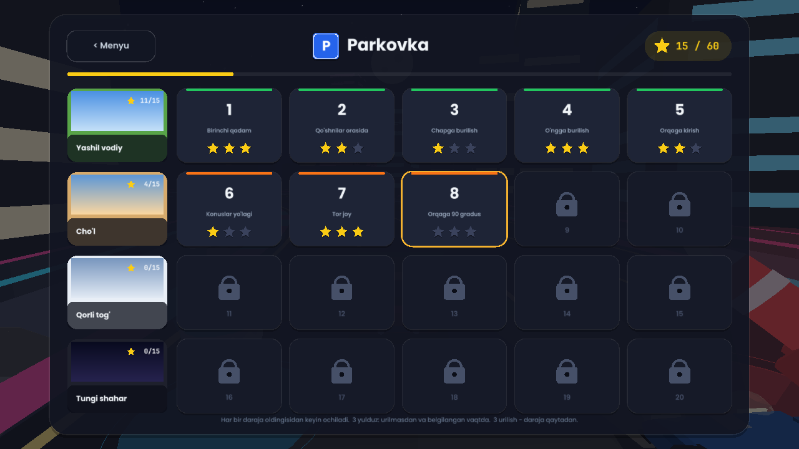 | 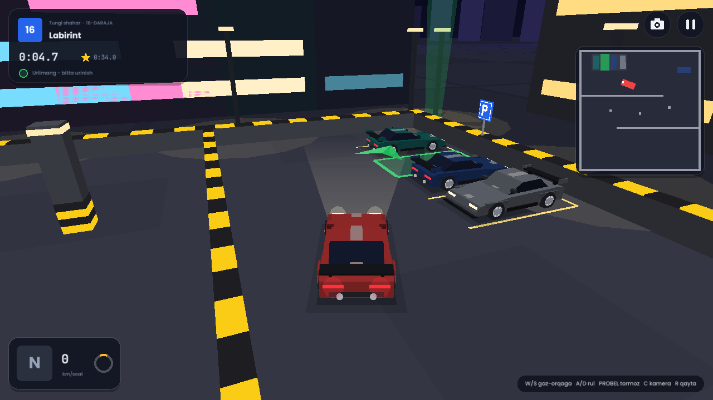 |

| Yuqoridan ko'rinish | Natija |
|---|---|
| 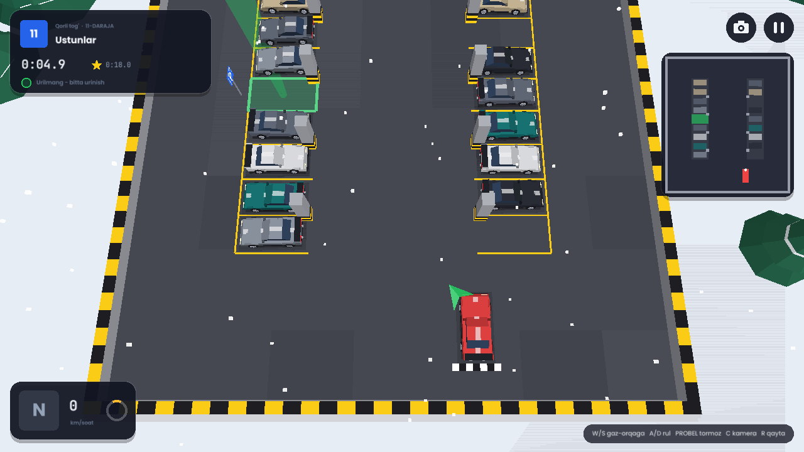 | 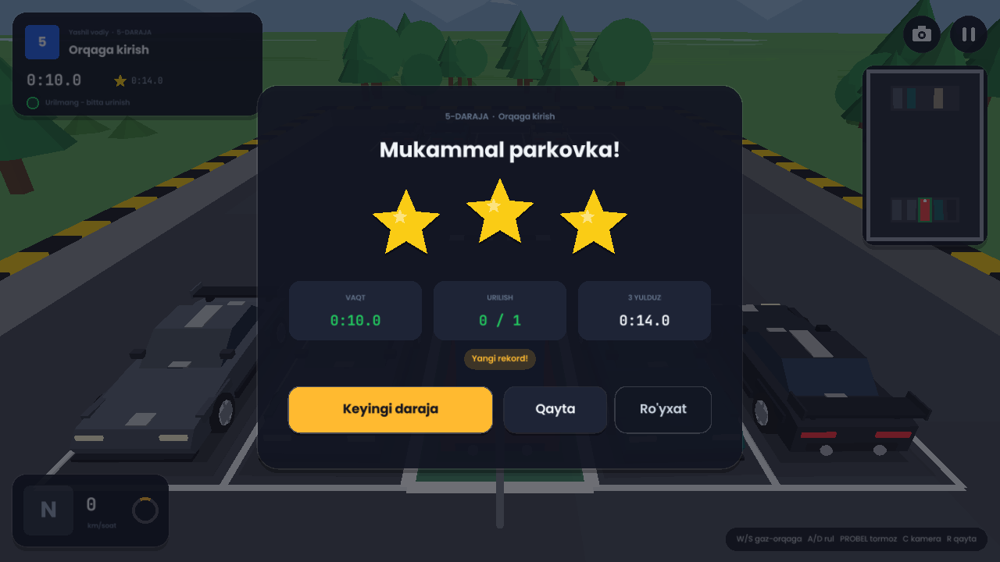 |

## Xaritalar

| Xarita | Uzunligi | Xususiyati |
|---|---|---|
| **Yashil vodiy** | 2.0 km | o'rmon, keng burilishlar - boshlash uchun |
| **Cho'l** | 2.1 km | kaktuslar, qoyalar, jazirama quyosh |
| **Qorli tog'** | 2.2 km | eng uzun va eng burilishli, qor yog'adi |
| **Tungi shahar** | 1.7 km | neon chiroqlar, osmono'par binolar, faralar yo'lni yoritadi |

Xaritani host kutish xonasida tanlaydi (sichqoncha yoki `1`-`4` tugmalari), mijozlarda trassa avtomatik almashadi.

## Qurollar

Blur'dagidek har bir qurolni **oldinga** yoki **orqaga** ishlatish mumkin, keraksiz qurolni esa **tashlab yuborib**, boshqa qutini olsa bo'ladi.

| Qurol | Shakli | Oldinga (`Probel`) | Orqaga (`Q`) |
|---|---|---|---|
| **Nitro** | ko'k ballon, olov tillari | 3 soniya 223 km/soatgacha tezlanish | keskin tormoz (burilishga kirishda) |
| **Raketa** | qizil raketa, qanotli | oldingizdagi mashinani quvib boradi | orqangizdagi mashinani quvadi |
| **Chaqmoq** | sariq zigzag | oldinga 3 ta tez o'q | orqaga o'q |
| **Mina** | to'q sariq tikanli shar | ~30 m oldinga, yo'lga tushadi | ortingizga tashlanadi |
| **Zarba** | binafsha shar, aylanuvchi halqalar | atrofdagi mashinalarni itaradi | xuddi shunday |
| **Qalqon** | yashil olti burchak | 8 soniya bitta zarbadan himoya | xuddi shunday |

`E` - qurolni tashlab yuborish. Har bir quti ichidagi qurol uzoqdan ko'rinib turadi, shuning uchun kerakli qurolni tanlab olish mumkin. Quti olinganda 4 soniyadan keyin ichida boshqa qurol bilan qayta paydo bo'ladi. Qurol tekkan mashina bir zum aylanib qoladi va tezligini yo'qotadi.

## Parkovka rejimi

Bitta o'yinchi uchun, internet yoki tarmoq kerak emas. Vazifa: mashinani yashil joyga chiziqlar ichida, tekis qilib qo'yish va 1 soniya to'xtab turish. Ba'zi darajalarda mashina **orqasi bilan** kirishi kerak (joyda ko'k strelkalar shuni ko'rsatadi).

| Guruh | Darajalar | Nimani o'rgatadi |
|---|---|---|
| Yashil vodiy | 1-5 | to'g'ri kirish, chapga/o'ngga burilish, orqaga kirish |
| Cho'l | 6-10 | konuslar orasidan o'tish, tor joy, orqaga 90 gradus, parallel parkovka, garaj |
| Qorli tog' | 11-15 | ustunlar, qiya joylar, ilon yo'li, qisqa parallel joy, yuk mashinalari |
| Tungi shahar | 16-20 | labirint, tor ko'chada ortga burilish, garajga orqa bilan, ikki tomonlama ko'cha, "Usta" |

- **Faqat bitta urinish:** devor, mashina yoki konusga bir marta urilsangiz, daraja tugaydi va qaytadan boshlanadi (juda sekin, ~3 km/soatdan past tezlikda tegish urilish hisoblanmaydi - mashina shunchaki to'xtaydi).
- **3 yulduz** - belgilangan vaqt ichida; **2 yulduz** - bu vaqtdan 1.7 baravargacha; **1 yulduz** - shunchaki o'tish.
- Har bir daraja oldingisidan keyin ochiladi. Natijalar `turbojang_parking.dat` faylida saqlanadi.
- `C` tugmasi kamerani almashtiradi: mashina ortidan yoki yuqoridan.

Barcha 20 daraja haqiqatan yechilishi test bilan tekshirilgan: `tests/parking_test.c` har bir daraja uchun **Hybrid A\*** qidiruvi bilan (mashinaning haqiqiy burilish radiusi, oldinga va orqaga) yo'l topadi, so'ng shu yo'lni o'yinning o'z fizikasi bilan haydab, mashina joyiga kirishini tekshiradi.

## Boshqaruv

| | Gaz / tormoz | Rul | Oldinga otish | Orqaga otish | Tashlash |
|---|---|---|---|---|---|
| Kompyuter | `W` / `S` yoki `↑` / `↓` | `A` / `D` yoki `←` / `→` | `Probel` / `Enter` | `Q` | `E` |
| Geympad | RT / LT | chap stik | `A` | `B` yoki `LB` | `Y` |
| Telefon | gaz avtomatik, "TORMOZ" | chap pastdagi ◀ ▶ | "OT" | "ORQAGA" | "✕" |

**Parkovka:** `W` - oldinga, `S` - tormoz/orqaga, `A`/`D` - rul, `Probel` - qo'l tormozi, `C` - kamera, `R` - qayta boshlash. Telefonda: ◀ ▶, "GAZ", "ORQAGA", "TO'XTA".

`ESC` tugmasi pauza menyusini ochadi. Trassadan chiqsangiz, o'tda mashina sekinlashadi. Teskari yo'nalishda ketsangiz, ekranda ogohlantirish chiqadi.

## Qanday o'ynaladi

1. Hamma bitta hotspotga ulanadi.
2. Bir kishi **"O'yin yaratish"** tugmasini bosadi. Ekranda uning IP manzili chiqadi.
3. Qolganlar **"O'yinga qo'shilish"** tugmasini bosadi. Host ro'yxatda o'zi paydo bo'ladi, paydo bo'lmasa IP ni qo'lda kiriting.
4. Host xaritani, aylanalar sonini (2, 3 yoki 5) va botlar darajasini tanlab, **"Poygani boshlash"** tugmasini bosadi.

> **Windows:** birinchi ishga tushirilganda Firewall ruxsat so'raydi. **Private va Public** belgilarining ikkalasini ham qo'ying.
> **Android:** "Noma'lum manbalardan o'rnatish"ga ruxsat bering.

## Texnik tafsilotlar

**Trassalar** (`track.c`) har bir xarita uchun 17-24 ta tayanch nuqtadan Catmull-Rom egri chizig'i bilan hosil qilinadi. Test trassaning qismlari bir-biriga 70 m dan yaqin kelmasligini tekshiradi. Trassa har 3 metrda bitta namunaga bo'linadi. Mashinaning yo'l bo'ylab masofasi va markazdan chetlanishi oldingi namuna atrofidan qidirib topiladi. Bu aylanalarni sanash, o'rinni aniqlash va botlarni boshqarish uchun ishlatiladi.

**Xaritani almashtirish** faqat asosiy oqimda bajariladi: mijozning tarmoq oqimi holatni faqat nusxalaydi, asosiy oqim esa `map_id` o'zgarganini ko'rib trassani qayta quradi. Shu bilan tarmoq oqimi chizilayotgan trassani o'zgartirib qo'yadigan poyga holati (race condition) bo'lmaydi.

**Fizika** arkada uslubida. Tezlik oshgani sari rul sekinroq buriladi, shuning uchun keskin burilishlarda tezlikni pasaytirish kerak. Yo'ldan chiqqan mashina o'tda sekinlashadi, trassa chetida esa to'siq bor.

**Botlar** oldindagi nuqtaga qarab rul buradi. Oldinda keladigan burilishning keskinligidan xavfsiz tezlikni hisoblaydi, qutilarga yo'nalib, minalardan qochadi. Qurollarni vaziyatga qarab ishlatadi: chaqmoqni oldida yoki orqasida mashina bo'lsa shu tomonga, minani orqadagiga tashlaydi yoki oldindagining yo'liga otadi, birinchi o'rinda bo'lsa raketani orqaga uchiradi.

## Operatsion tizim tushunchalari

| Tushuncha | Qayerda ishlatilgan |
|---|---|
| **Oqimlar (threads)** | Server, mijoz va host qidiruvi alohida qabul qiluvchi oqimlarda ishlaydi (`net.c`). Asosiy oqim fizika va chizishni bajaradi |
| **Sinxronizatsiya (mutex)** | Tarmoq oqimi va asosiy oqim umumiy `GameState` ga faqat mutex orqali kiradi |
| **Jarayonlararo aloqa (IPC)** | Turli qurilmalardagi jarayonlar UDP soketlar orqali xabar almashadi |
| **Broadcast** | Host `255.255.255.255` va `x.y.z.255` manzillariga yuborilgan so'rovlar orqali topiladi |
| **Platforma abstraksiyasi** | `plat.c` bitta interfeys ortida Win32 (`CreateThread`, `CRITICAL_SECTION`, Winsock2) va POSIX (`pthread`, BSD sockets) API'larini yashiradi |
| **Real vaqt rejalashtirish** | Server qat'iy 60 Hz qadam bilan ishlaydi. Mijoz holatlar orasidagi harakatni ekstrapolyatsiya qilib silliq chizadi |
| **Ishonchsiz kanalda ishonchlilik** | O'q uzish buyrug'ida tartib raqami (`fire_seq`) va rejimi (oldinga/orqaga/tashlash) bor. UDP paketi yo'qolsa ham, ikki marta kelsa ham, qurol aynan bir marta ishlatiladi |

### Arxitektura

```
 ┌─────────── Host (slot 0) ───────────┐            ┌──────── Mijoz (slot 1..3) ────────┐
 │ asosiy oqim:                        │   INPUT    │ asosiy oqim:                      │
 │   game_step() 60 Hz → 3D chizish    ◄──────────── rul, gaz, fire_seq, rejim → send() │
 │ server oqimi:                       │  (6 bayt)  │ mijoz oqimi:                      │
 │   recvfrom() → mutex → inputs[]     │   STATE    │   recvfrom() → mutex → GameState  │
 │   game_serialize() → sendto() ──────────────────►  asosiy oqim → 3D chizish        │
 └─────────────────────────────────────┘ (~200-600 b)└──────────────────────────────────┘
```

Server avtoritar: fizika, qurollarning tegishi va o'rinlarni faqat host hisoblaydi. Mijoz faqat rul, gaz va o'q uzish holatini yuboradi.

## Loyiha tuzilmasi

```
src/plat.c, plat.h      OT qatlami: oqimlar, mutex, vaqt, UDP soketlar (Win32 / POSIX)
src/net.c, net.h        server, mijoz, hostni topish
src/track.c, track.h    trassa: egri chiziq, namunalar, joy aniqlash, daraxtlar
src/game.c, game.h      fizika, qurollar, qutilar, aylanalar, o'rinlar, botlar
src/parking.c, .h       parkovka: 20 daraja, mashina fizikasi, to'qnashuv (SAT), baholash
src/main.c              raylib: 3D sahna, effektlar, HUD, minikarta, menyular, ovoz
src/fonts_data.c        dastur ichiga joylangan shriftlar
tests/net_test.c        trassa, tarmoq va to'liq poyga testlari
tests/parking_test.c    20 daraja yechiladimi (Hybrid A* + fizika bilan haydash)
android/                Gradle loyihasi (NativeActivity + C kodi)
.github/workflows/      GitHub Actions: testlar, .exe va .apk
```

## Yig'ish

GitHub'ga yuklanganda **Actions** bo'limi o'zi `TurboJang.exe` va `TurboJang.apk` ni yig'adi. Ular *Artifacts* qismida bo'ladi. `v1.0` kabi teg qo'yilsa, **Releases** sahifasiga ham joylanadi.

```bash
# Makefile orqali
make && make test

# Windows (MinGW yoki Visual Studio + CMake)
cmake -B build && cmake --build build --config Release

# Linux'da Windows uchun
cmake -B build-win -DCMAKE_TOOLCHAIN_FILE=cmake/mingw-w64.cmake -DCMAKE_BUILD_TYPE=Release
cmake --build build-win --target turbojang

# Testlar
gcc -Isrc tests/net_test.c src/game.c src/track.c src/net.c src/plat.c -lm -lpthread -o net_test && ./net_test
gcc -O2 -Isrc tests/parking_test.c src/parking.c -lm -o parking_test && ./parking_test
```
